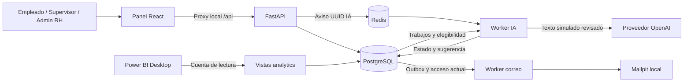
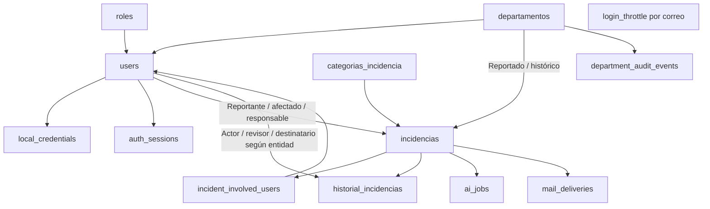

# Arquitectura de PluriOne

## Alcance de la descripción

Documento de la estructura implementada en el repositorio, revisada mediante código y configuración. Describe el entorno local y sus límites; no certifica un despliegue productivo, una ejecución nueva de servicios ni aprobación institucional. Las reglas funcionales pertenecen al [PRD](PRD.md), el propósito a la [propuesta técnica](PROPUESTA_TECNICA.md) y los pendientes al [MVP](MVP.md).

## Contexto y límites de confianza

El navegador no es una autoridad de permisos. FastAPI obtiene al actor de la sesión y revalida el acceso; conocer un ID o recibir un enlace no concede visibilidad. PostgreSQL es la fuente de datos, trabajos e historial. Redis solo transporta avisos de IA y el proveedor externo recibe únicamente el texto revisado autorizado para ese envío. Gerencia consume agregados, sin convertirse en rol de expedientes.

## Componentes y responsabilidades

| Componente | Responsabilidad | Fuente de implementación |
| --- | --- | --- |
| Panel React | Formularios, navegación, consulta y estados de operación; token en memoria | [frontend/src](../frontend/src), [Vite](../frontend/vite.config.js) |
| Aplicación FastAPI | Routers, contratos y errores sanitizados | [main.py](../backend/app/main.py), [api](../backend/app/api) |
| Seguridad | Hash de contraseña, sesión, revocación, bloqueo de intentos y actor vigente | [security.py](../backend/app/core/security.py) |
| Servicios de negocio | Acceso por objeto, ciclo, participantes, protección y cambios administrativos | [services](../backend/app/services) |
| Persistencia | Modelos, restricciones, conexión y cambios de esquema | [models](../backend/app/models/__init__.py), [database.py](../backend/app/core/database.py), [migrations](../backend/migrations) |
| IA | Proveedor, salida estructurada, avisos y procesamiento durable | [ai](../backend/app/ai), [servicio IA](../backend/app/services/ai.py) |
| Correo | Destinatarios elegibles, outbox, propietario de trabajo y transporte | [servicio mail](../backend/app/services/mail.py), [mail](../backend/app/mail) |
| Analítica | Vistas con supresión y provisión de cuenta de lectura | [SQL analítico](../backend/migrations/versions/0007_analytics_views.sql), [reporting](../backend/app/reporting) |
| Orquestación local | Contenedores, red, variables y volúmenes | [Compose](../compose.yaml), [override BI](../compose.bi.yaml) |

Las rutas no se limitan a persistir cualquier cuerpo recibido: usan contratos y servicios con autorización. El frontend oculta o muestra acciones para orientar al usuario, mientras el servidor comprueba la regla efectiva. El código comparte modelos y servicios entre API y workers; los workers no realizan sus operaciones a través de la sesión del navegador.

## Flujo de una operación de negocio

```mermaid
sequenceDiagram
    actor Gestor
    participant UI as React
    participant API as FastAPI
    participant S as Servicios
    participant DB as PostgreSQL
    Gestor->>UI: Confirmar una operación permitida
    UI->>API: Solicitud con sesión
    API->>DB: Comprobar identidad y cuenta activa
    API->>S: Validar entrada y actor
    S->>DB: Coordinar bloqueo y reevaluar acceso/estado
    S->>DB: Cambio + auditoría + outbox si corresponde
    alt Reglas y persistencia correctas
        S->>DB: Commit
        API-->>UI: Acuse o respuesta permitida
    else Rechazo o fallo
        S->>DB: Revertir cambios de la operación
        API-->>UI: Error sanitizado
    end
```

La auditoría de negocio se confirma con el cambio, y los eventos de correo se guardan cuando corresponde dentro de la misma transacción. La comprobación inicial de sesión no reemplaza la reevaluación de permisos bajo los bloqueos de la mutación. No se fuerza una transacción distribuida con servicios externos.

## Identidad, autorización y concurrencia

Las contraseñas se verifican mediante Argon2id. El token de sesión es aleatorio y opaco; PostgreSQL conserva su digest y revocación. No se usa JWT ni identidad Entra en el flujo actual. Cambio de contraseña y cambios administrativos relevantes revocan sesiones según el servicio.

La visibilidad considera cuenta y departamento activos, rol, ámbito, afectado, relaciones declaradas/confirmadas y confidencialidad. Asignación no supera una exclusión. Un Admin RH involucrado tampoco puede gestionar ese caso; otro RH independiente necesita ser provisionado por el operador cuando no exista.

Las mutaciones administrativas y de expedientes se coordinan mediante [administration_lock.py](../backend/app/services/administration_lock.py): bloqueo advisory transaccional exclusivo o compartido en PostgreSQL, además de bloqueos por fila y revalidaciones específicas. SQLite no reproduce esa garantía; las comprobaciones de persistencia/concurrencia requieren PostgreSQL. El detalle de cada servicio y las carreras pendientes se mantiene en QA, sin afirmar que todos los intercalados posibles estén verificados.

## Modelo lógico

Es un mapa de entidades y referencias principales, no un diagrama de cardinalidades exhaustivo. `login_throttle` controla intentos por correo, incluidas cuentas inexistentes; no debe interpretarse como una FK obligatoria a users. La resolución del ciclo actual está en la incidencia; los ciclos anteriores se conservan en la auditoría, sin inventar una tabla de ciclos independiente.

Las restricciones y campos concretos se consultan en los modelos y migraciones. El departamento al crear el caso se conserva para analítica; un traslado del afectado no reescribe esa dimensión histórica. Los catálogos y sus IDs son distintos de identidades personales.

## Asistencia IA

1. Un gestor elegible revisa texto simulado en un formulario vacío y confirma las condiciones de envío. No se copia automáticamente la descripción del expediente.
2. La API guarda revisión, solicitud, catálogo y procedencia en PostgreSQL. Redis recibe un UUID; una notificación fallida no elimina el trabajo confirmado.
3. El worker reclama un trabajo con propietario y vencimiento; comprueba permisos, contenido y estado antes de enviar. Libera la transacción durante la llamada al proveedor.
4. El proveedor recibe instrucciones, catálogo y texto revisado. Devuelve una estructura validada con clasificación o abstención, sin herramientas para ejecutar acciones del sistema.
5. El worker revalida propietario, contenido y elegibilidad al persistir. Conserva la primera respuesta aceptada y descarta resultados operativamente inválidos.

La petición externa puede haber comenzado antes de una restricción posterior; descartar la respuesta no revoca los datos ya enviados. La recuperación después de una interrupción puede repetir llamada y coste. Una sugerencia no cambia la clasificación oficial ni habilita transiciones sin la confirmación humana. Configuración, reintentos y evaluación en [IA.md](IA.md).

## Correo por eventos

La outbox durable almacena avisos asociados a creación, asignación, resolución o reapertura. El worker consulta PostgreSQL sin depender de Redis; revisa el destinatario y el acceso vigentes antes de SMTP. El mensaje contiene aviso genérico, identificador y enlace, sin descripción del caso.

La unicidad del registro evita duplicar la misma combinación de evento/destinatario en la outbox. No garantiza entrega exactamente una vez: si SMTP acepta y el proceso falla antes de confirmar el estado en la base, puede repetirse el transporte. Los bloqueos durante el envío coordinan cambios de protección y tienen un coste de espera limitado por los timeouts de transporte; no son una transacción compartida con SMTP.

Mailpit es el destino configurado para pruebas. «Aceptada por SMTP» no demuestra entrega a un buzón externo ni lectura. Fallos definitivos y transitorios tienen tratamiento separado e intentos acotados. Reglas y límites en [CORREO.md](CORREO.md).

## Analítica y Power BI

Las vistas `analytics.incident_metrics` y `analytics.export_info` aplican exclusiones antes de exportar. La celda se define por mes de creación, categoría oficial y departamento histórico; si un subconjunto no vacío o su complemento incumple el mínimo, se suprimen todos los valores de esa celda. No se publican expedientes individuales ni totales que reconstruyan cifras ocultas.

La cuenta BI recibe SELECT sobre ambas vistas y no sobre tablas operativas. La provisión comprueba privilegios heredados inseguros y revierte si existen; el modo read-only por sí solo no sustituye esos permisos. Power BI importa una instantánea y muestra corte y población parcial. Un filtro visual no es el control de privacidad y un refresco no revoca una copia ya distribuida.

El informe guardado tiene tabla, cuatro medidas, tarjeta de corte y leyenda. Su definición de visuales se revisó estáticamente, pero no se decodificó el modelo binario completo. Faltan revisión semántica, valores publicables/formatos, refresco y custodia. Fórmulas y mínimos en [ANALITICA.md](ANALITICA.md); fuentes en [powerbi](../powerbi/README.md).

## Despliegue local y secretos

| Elemento | Exposición predeterminada | Persistencia o límite |
| --- | --- | --- |
| React/Vite | Loopback 5173, proceso fuera de Compose | Desarrollo; build no configura un servidor productivo |
| API | Loopback 8000 configurable | Imagen sin privilegios; su healthcheck solo comprueba proceso HTTP |
| PostgreSQL | Red Compose interna | Volumen nombrado; override BI opcional abre solo loopback 5433 |
| Redis | Red Compose interna | AOF y volumen nombrado; no es autoridad de trabajos |
| Worker IA | Sin puerto publicado, perfil ai | Clave OpenAI solo en su entorno; salida a proveedor externo |
| Worker correo | Sin puerto publicado, perfil mail | SMTP de captura interno |
| Mailpit | Panel en loopback 8025; SMTP sin publicar | Buzón de pruebas, no archivo de auditoría duradero garantizado |
| Power BI Desktop | Proceso local con conexión de lectura | Archivo importado sujeto a custodia y refresco manual |

Compose lee la configuración privada local; la API no carga `.env` por sí misma. No se deben imprimir variables resueltas ni llevar claves a variables VITE_. API y workers comparten actualmente las credenciales PostgreSQL operativas configuradas; la separación de procesos no demuestra separación de privilegios de base. La cuenta BI sí dispone de un procedimiento independiente de lectura limitada.

Para instalación y actualización usa el [manual técnico](MANUAL_TECNICO.md). Cambiar puertos requiere ajustar consumidores, incluido el proxy web. Los volúmenes persistentes no sustituyen un respaldo probado. HTTPS externo, secretos administrados, monitorización, recuperación y separación adicional de privilegios requieren preparación antes de producción.

## Verificación y deuda pendiente

| Área | Evidencia o fuente | Límite actual |
| --- | --- | --- |
| HTTP y seguridad | [tests](../backend/tests), [QA](REPORTE_QA.md) | No equivale a aceptación completa por rol |
| Persistencia y permisos | Pruebas PostgreSQL aisladas; [runner](PRUEBAS_POSTGRESQL.md) | No acredita el estado presente de la base operativa ni todas las carreras |
| UI | Pruebas de componentes y recorridos registrados | Completar móvil, accesibilidad y matriz integral |
| IA | Evaluaciones y recorrido; [resultado](evaluacion_ia/RESULTADOS_V4.md) | Casos simulados y discrepancias conservadas; sin garantía de generalización |
| Correo | Evidencias 85–92 | Completar negativos/fallos en recorrido real |
| Analítica | Evidencias 93–95/98 | Modelo, valores publicables, refresco y custodia pendientes |
| CI | [Backend](../.github/workflows/backend.yml), [frontend](../.github/workflows/frontend.yml) | Definir workflow no acredita una ejecución remota del cambio actual |
| Operación | Guías, configuración y recuperación lógica nativa verificada (103) | Medición de carga, secuencia Docker, instalación completa, soporte y aceptación final pendientes |

Este documento se validó contra rutas y símbolos del repositorio. Su elaboración no ejecutó servicios, no consultó datos operativos ni repitió evaluaciones con coste. Las pruebas nuevas realizadas para el documento y sus límites se registran en QA y bitácora.
